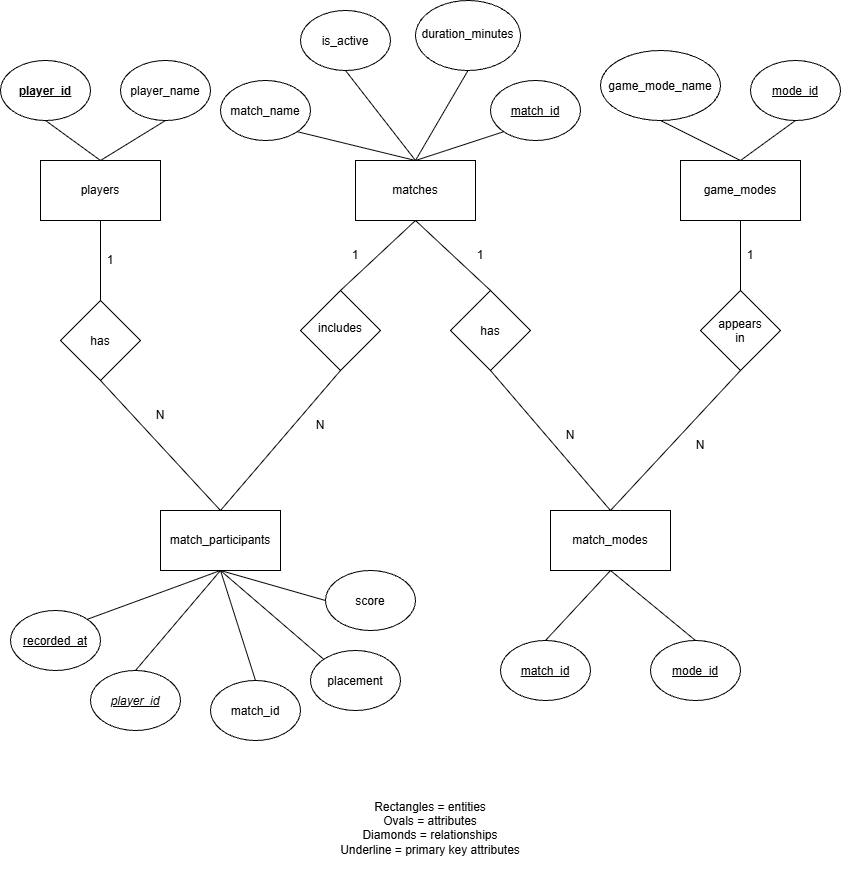

# Simplified TFT Game Telemetry Database

**Student:** Jonah Camacho
**Course:** EX 603
**Theme:** Game Telemetry

A database that stores players, matches, placements, game modes, and scores for a simplified TFT-style game.

## Domain

This project focuses on player results from a simplified Teamfight Tactics game. Each match allows eight finishing positions with no ties. Results are recorded once a player's placement is final. The project uses score = 9 - placement, giving first place eight points and eighth place one point. This is a simplified scoring system.

The database will support questions about average placement, top-four finishes, total scores, and player activity over time. It also stores match duration and whether a match is in progress or has ended. Matches can have multiple mode labels, such as Standard and Ranked. Game details such as champions, items, and individual rounds are outside the project's scope.

## ERD

## Project Files

- [Relation schemas](schema/schema-definition.md)
- [Integrity constraints](schema/constraints.md)
- [Modelling justification and reflection](analysis/unit1.md)
- [Editable ERD](schema/erd.drawio)