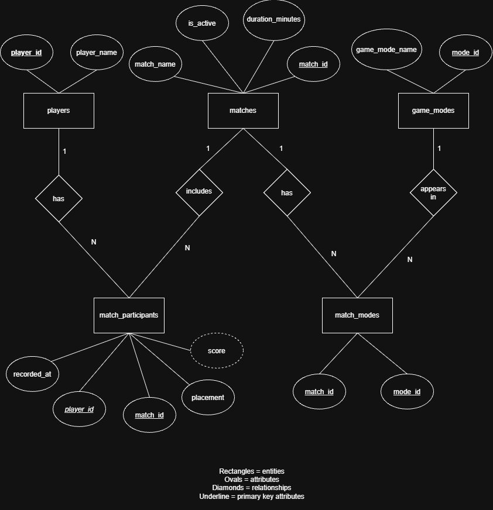

# EX603 Game Telemetry Database
# Simplified TFT Game Telemetry Database

**Student:** Jonah Camacho
**Course:** EX603
**Course:** EX 603
**Theme:** Game Telemetry
A PostgreSQL database for a simplified TFT-style game, with reports on player activity and network timeouts.

## Domain

I started this project by modeling players, matches, placements, game modes, and scores. A match has eight possible finishing positions with no ties, and I record a player's result once their placement is final. I used `score = 9 - placement`, so first place gets eight points and eighth place gets one. The model also tracks match duration and whether a match is still in progress. A match can have more than one mode label.

For the later units, I used the course's sample game telemetry data. Each player's participation in a match counts as one event. I wanted to find out how often players timed out, which matches had the highest timeout rates, and whether the rate improved over time. I counted an event as a confirmed timeout when its status was `abandoned` and its disconnect reason was `Network timeout`. I used all recorded participations to calculate the rate.

## Database overview

This ERD shows the design I built in Units 1 and 2.



- [Relation schemas](schema/schema-definition.md)
- [Integrity constraints](schema/constraints.md)
- [Unit 1 design decisions and reflection](analysis/unit1.md)
- [Editable ERD](schema/erd.drawio)

The reports in Units 3–6 use the reference schema and sample data from Unit 3. `match_participants` stores each event's join time, score, status, and disconnect reason. `matches` has match names and server regions, and `players` identifies who participated. `match_modes` connects matches to the labels in `game_modes`. [Reference schema and data](gaming.sql)

## Query catalogue

| Unit | SQL file | Question |
| --- | --- | --- |
| 2 | [schema.sql](schema/schema.sql) | What rules keep player, match, and placement records consistent? |
| 3 | [q3_1.sql](queries/unit3/q3_1.sql) | Which events match the score, status, and duration filters? |
| 3 | [q3_2.sql](queries/unit3/q3_2.sql) | Why did the dashboard filter leave out events, and what is the correct timeout rate? |
| 3 | [q3_3.sql](queries/unit3/q3_3.sql) | Which players had network timeouts in ranked matches? |
| 4 | [q4_1.sql](queries/unit4/q4_1.sql) | How do activity, scores, and timeout rates vary across matches and regions? |
| 4 | [q4_2.sql](queries/unit4/q4_2.sql) | Which matches had the most timeouts, and what was the overall rate? |
| 5 | [q5_1.sql](queries/unit5/q5_1.sql) | Who joined each match, and how did Matches 2 and 3 compare with others in their regions? |
| 5 | [q5_2.sql](queries/unit5/q5_2.sql) | Which matches had no recorded participation? |
| 5 | [q5_3.sql](queries/unit5/q5_3.sql) | How many match and mode combinations are possible, and how does PostgreSQL run the participation joins? |
| 6 | [q6_1.sql](queries/unit6/q6_1.sql) | How do scores compare with match averages, and how do ties affect the activity rankings? |
| 6 | [q6_2.sql](queries/unit6/q6_2.sql) | How do scores and timeouts change over time, and where are the gaps in participation? |
| 6 | [q6_3.sql](queries/unit6/q6_3.sql) | What are the top three scores per match, and how does the timeout rate change month to month? |

[Unit 6 write-up](analysis/unit6.md) · [Unit 6 closing memo](analysis/unit6-finding.md)

## Technical highlights

- **Conditional aggregation** let me count confirmed timeouts and all participations in the same query. The total still counted events with no recorded disconnect reason.
- **Joins** let me compare flagged matches with others in the same server region. I also used a `LEFT JOIN` to keep matches with zero recorded events in the activity report.
- **Common table expressions** helped me break the monthly report into steps. I could check the counts, fill in the calendar, and calculate each month's rate before comparing it with the previous month.
- **Window functions** let me keep each row and add more context. I used them to put individual scores next to their match average, rank matches by activity, and bring in the previous month's rate with `LAG()`.

## Findings and recommendations

1. The overall timeout rate was **6.00%**, with 12 confirmed timeouts in 200 events. The quarterly rate dropped from **7.55% in Q1 to 4.17% in Q4** in 2023. Both Q4 timeouts happened in December, which had 2 timeouts in 16 events. I'd start next quarter by reviewing the logs for those two incidents and tracking the timeout count alongside total participation. [Monthly report](queries/unit6/q6_3.sql)
2. **Match_02 and Match_03 accounted for 5 of the 12 timeouts.** Match_02 had 3 timeouts in 16 events, and Match_03 had 2 in 13. I'd compare their connection logs with other matches in the same server regions to see what the incidents had in common. [Timeouts by match](queries/unit4/q4_2.sql) · [Regional comparison](queries/unit5/q5_1.sql)
3. **Match_14 and Match_15 had no recorded participation.** I'd check the match schedule and the data load logs to see if the matches took place and whether their records made it into the database. [Match activity report](queries/unit5/q5_2.sql)

## Limitations and future improvements

The dataset only had 200 participation events for the whole year. Two incidents were enough to put December at 12.50%, so the monthly percentages can move a lot. I'd collect more participation history and include server IDs in the event data so I could check whether failures keep happening on the same servers.

## Screenshots

I saved my query and output captures in the [screenshots folder](screenshots/).

| Work | Screenshots |
| --- | --- |
| Unit 2 schema | [First run](screenshots/01-schema-first-run.png) · [Second run](screenshots/02-schema-second-run.png) · [Table list](screenshots/03-table-list.png) |
| Unit 3 dashboard audit | [NULL counts and filter fix](screenshots/u3-32a-null-counts-and-repair.png) · [Timeout rates](screenshots/u3-32a-v-32b-i-ii-rates-alias-error-expression-repair.png) |
| Unit 4 failure rates | [Timeouts by match](screenshots/u4-42a-conditional.png) · [Region and platform totals](screenshots/u4-42b-rollup.png) |
| Unit 5 joins | [Regional peer comparison](screenshots/u5-5.1-q3.png) · [Matches without events](screenshots/u5-5.2-A1-A2-A3.png) · [Execution plan](screenshots/u5-5.3.png) |
| Task 6.1 | [Window average part 1](screenshots/u6-61-window-average-p1.png) · [Part 2](screenshots/u6-61-window-average-p2.png) · [Part 3](screenshots/u6-61-window-average-p3.png) · [Part 4](screenshots/u6-61-window-average-p4.png) · [Grouped averages](screenshots/u6-61-group-average-and-rankings.png) · [Rankings](screenshots/u6-61-rankings.png) · [Activity bands](screenshots/u6-61-bands.png) |
| Task 6.2 | [Previous and next scores](screenshots/u6-62-neighbors.png) · [Participation gaps](screenshots/u6-62-gaps.png) |
| Task 6.3 | [Top three scores](screenshots/u6-63-top-three.png) · [Monthly timeout rates](screenshots/u6-63-monthly.png) |

## Video presentation

In the video I walk through how I checked the dashboard rate, compared matches, and used a window function to look at the monthly trend.

https://youtu.be/Ng6TqANVxtg

## How to run it

With PostgreSQL installed and `createdb` and `psql` available in your terminal, run these commands from the repository root. Use a fresh database for the setup because `gaming.sql` recreates the sample tables.

```sh
createdb -U postgres ex603_data
psql -X -U postgres -d ex603_data -v ON_ERROR_STOP=1 -f gaming.sql
psql -X -U postgres -d ex603_data -v ON_ERROR_STOP=1 -P pager=off -a -f queries/unit6/q6_3.sql
```

If you already loaded the course data into `ex603_data`, start with the last command. Use a different SQL path from the query catalogue to run another report.